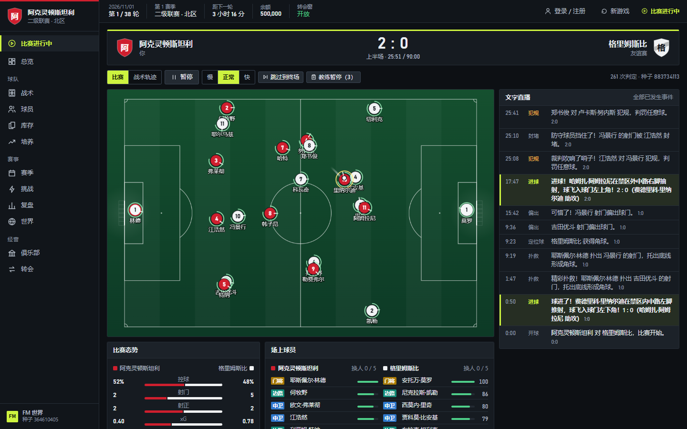
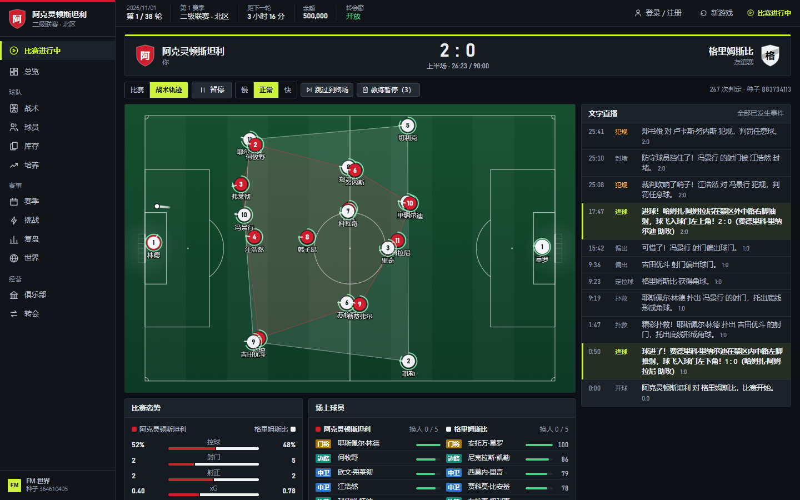
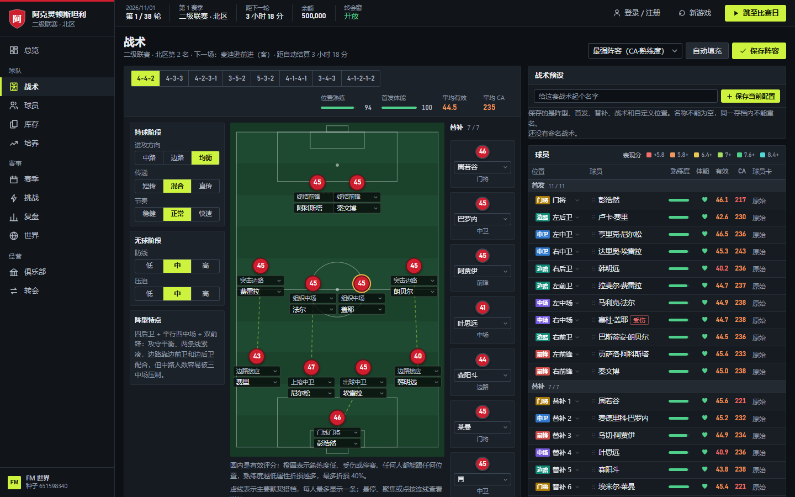
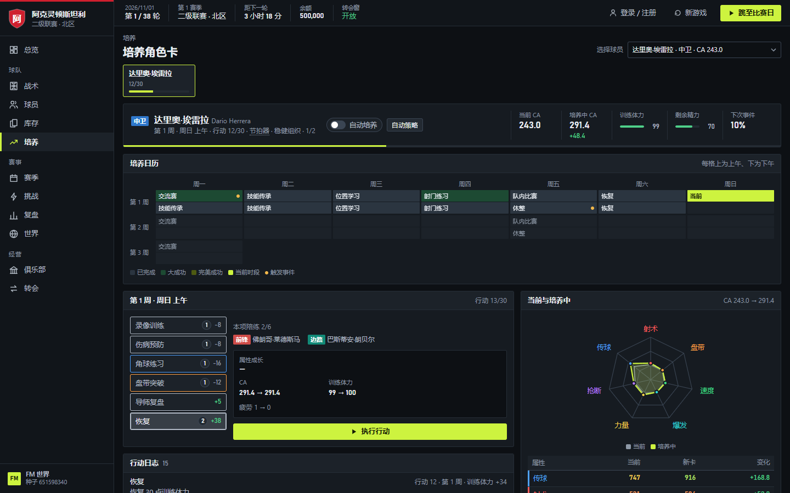
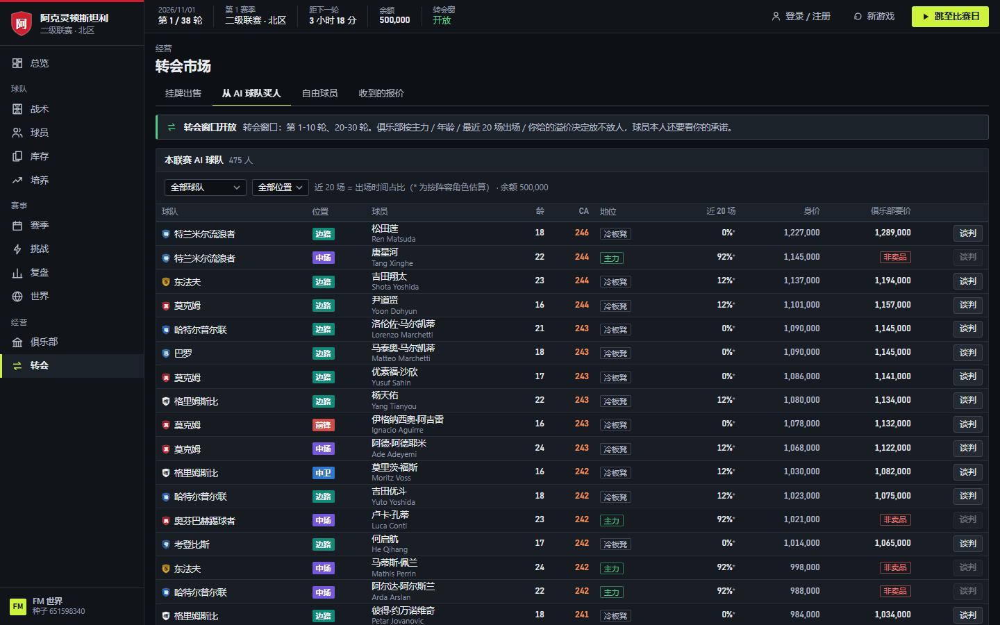

[中文](README.md) | **English**

# FM World

An 11-a-side football management game you play in the browser: take over a club, develop players, pick your tactics, handle transfers and finances, and play out a season in real time.

## Features

- **Real-time 2D matches**: a physics engine simulates the movement of all 22 players and the ball in real time, and every touch (pass, shot, tackle and so on) is resolved from the players' attributes. You can pause, change the speed and use coach timeouts to adjust tactics, with live text commentary and a post-match review.
- **Tactics**: several 11-a-side formations, a role for every position, free positioning on the tactics board and saved tactic presets.
- **Teammate chemistry**: overlapping match minutes and cooperative training build pair familiarity, giving a small passing benefit. View partners on the tactics board and player profiles. Switching cards preserves chemistry; relationships expire after six months (180 game days) without cooperation.
- **Player development**: a 30-session training calendar with friendlies, internal matches and training events; finishing a programme gives the player a new player card.
- **Transfers and finances**: buy players from computer-run clubs (starters, rotation players and bench warmers are priced differently), negotiate with the player himself and answer bids from other clubs. Upgrade facilities and pay wages every round; while wages are unpaid, your players perform at half strength.
- **Stamina and rotation**: each league match uses about 70% of a player's stamina, which then recovers hour by hour, so a busy schedule calls for rotation.
- **Shared online world**: all players compete in the same three-tier league system with promotion and relegation, matches kick off every day at 12:00 and 20:00 Beijing time, and free agents are auctioned server-wide. You can also play offline on your own.
- **AI coaching**: let an AI assistant manage your club through the Agent API or MCP; see [docs/agent-api.md](docs/agent-api.md) (in Chinese).

## Screenshots

**Real-time 2D match**: all 22 players and the ball move in real time according to their attributes, with live text commentary on the right and possession, shots and xG below.



**Tactical tracking view**: overlays your team's shape on the pitch so you can read the overall positioning.



**Tactics board**: pick a formation, give every position a role and set in-possession and out-of-possession tactics; the dashed lines on the board connect the main chemistry partners.



**Player development**: a 30-session training calendar with friendlies, internal matches and training events; the radar chart on the right shows attribute changes.



**Transfer market**: buy from computer-run clubs, with each player's share of the last 20 matches, valuation and the club's asking price; first-choice players are marked "not for sale".



> Screenshots are from offline single-player mode at 1440×900; the interface is in Chinese. Player and club names are prototype gameplay-test data; see the disclaimer below.

## Quick start

Requires Node.js **22.13 or newer** (uses built-in `node:sqlite`; no database service to install).

```bash
npm install
npm run build
npm run server   # then open http://localhost:8787
```

The game's interface is in Chinese.

## Online storage

- Accounts, password hashes, Agent tokens, game saves and login sessions live in `data/accounts.sqlite`. Only changed accounts are updated.
- Ordinary saves are coalesced in an approximately one-second window and written by a background worker. Normal shutdown (`SIGINT` / `SIGTERM`) flushes pending changes; power loss or `kill -9` can still lose changes in that short window.
- On first startup, legacy `accounts.json` / `sessions.json` are imported together in a transaction and retained unchanged. SQLite is authoritative afterward; legacy files are not re-imported. Invalid legacy data stops startup rather than silently creating an empty account store.
- The shared world remains in `data/world.json`, with match jobs in `data/match-jobs/`. Shared-data deduplication and the SSE protocol are unchanged.
- Stop the server normally before backing up the whole `data/` directory. Do not copy only the `.sqlite` file while running: WAL mode may also use `accounts.sqlite-wal` / `accounts.sqlite-shm`.

## Disclaimer

- This is a non-commercial prototype developed by an individual. It is not affiliated with, authorized or endorsed by any football league, club, player or player representative, or by game publishers such as Football Manager / Sports Interactive / SEGA.
- All player abilities, attributes, potential, personalities, injury tendencies, market values, contracts, transfer preferences and match results in the game are fictional gameplay data generated by the program. They do not represent or evaluate the real ability or conduct of any real person or club.
- Randomly generated player and club names are fictional; any resemblance is coincidental. Some player and club names currently borrow real-world names for prototype gameplay testing only and have no connection with those people or clubs; they will be replaced with fictional names, or the necessary permissions obtained, before any public release. Rights holders with concerns are welcome to contact the author, and the content will be removed or changed promptly.
- In-game balances, income, wages and transfer fees are virtual values and cannot be exchanged for real money or goods.
- This project is provided "as is", and the author accepts no liability for any loss arising from its use.
