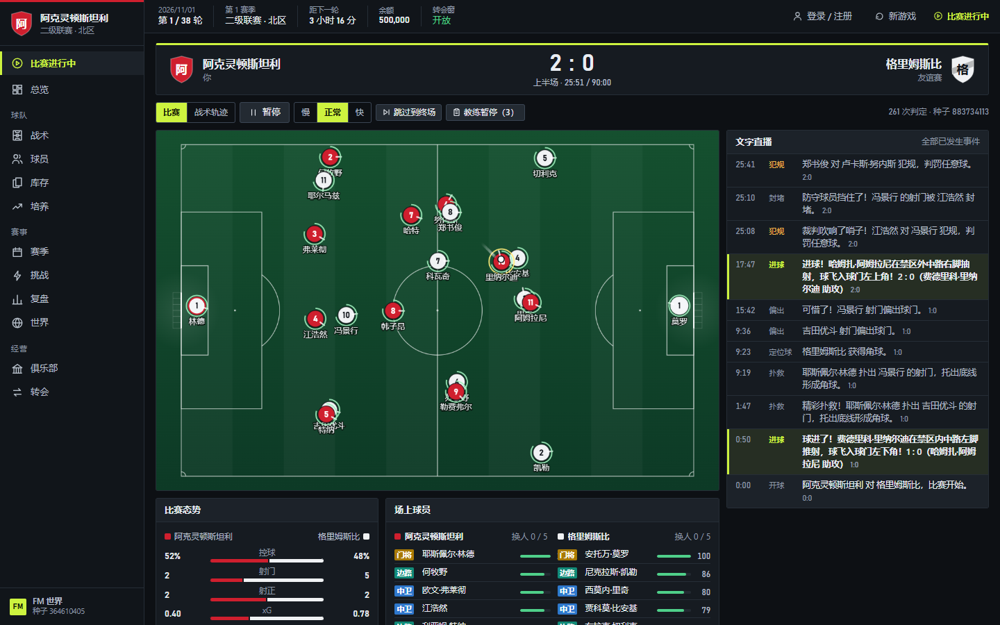
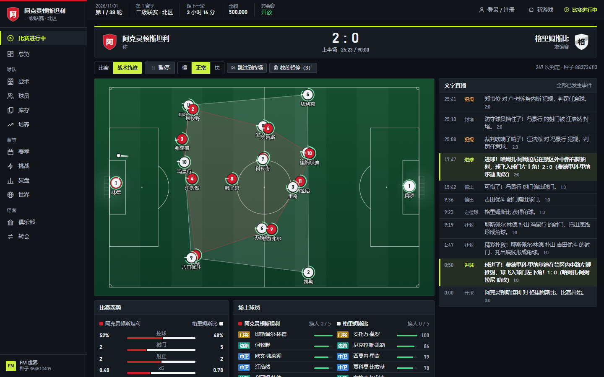
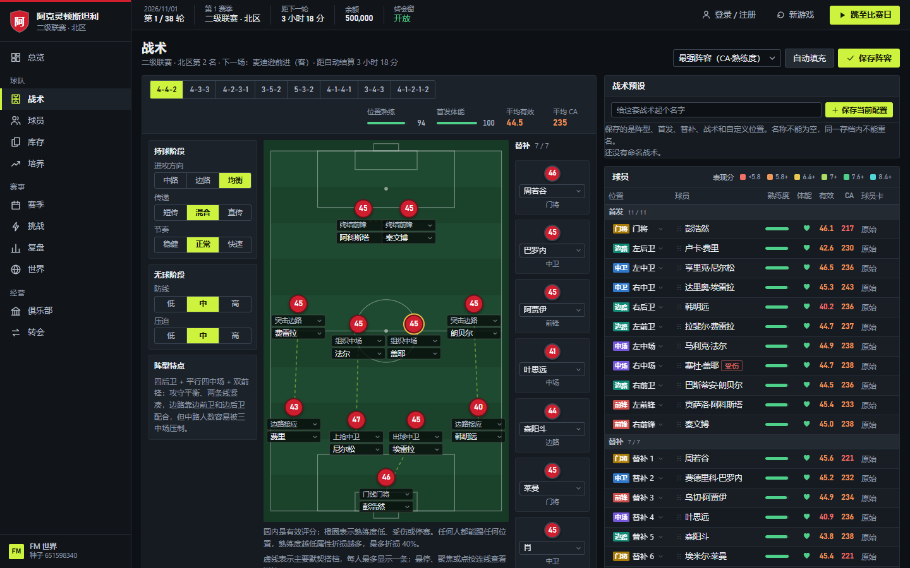
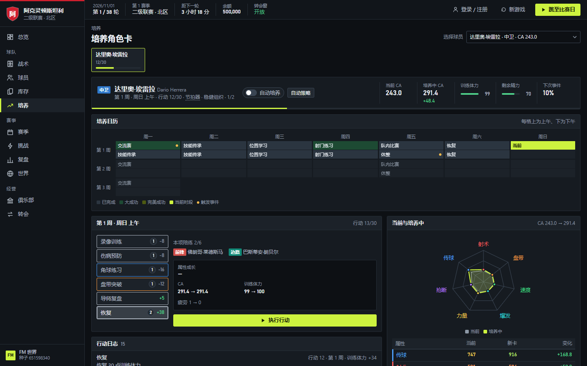
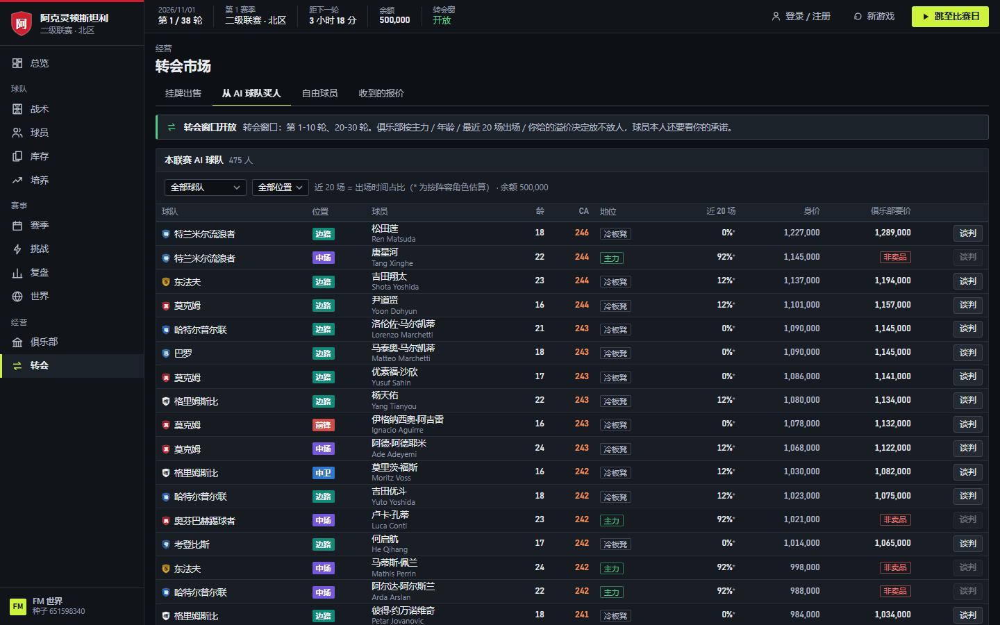

**中文** | [English](README.en.md)

# FM 世界

一款在浏览器里玩的 11 人制足球经理游戏：接手一支俱乐部，培养球员、排兵布阵、做转会和经营，在真实时间里踢完一个赛季。

## 特点

- **实时 2D 比赛**：物理引擎实时演算 22 名球员的跑位和球路，传球、射门、抢断等每一次接触都按球员属性结算；可以暂停、调速、用教练暂停调整战术，有实时文字直播和赛后复盘。
- **战术**：多种 11 人制阵型，每个位置都能指定职责，战术板上可以自由摆位，可以保存多套战术预设。
- **队友默契**：按实际共同上场时间与配合训练积累两人默契，小幅提升搭档间的传球配合；战术板与球员详情可查看。换卡保留，超过 6 个月（180 个游戏日）未合作的关系会移除。
- **球员培养**：一轮 30 个时段的培养日历，期间会遇到交流赛、队内比赛和训练事件，练成后获得一张新的球员卡。
- **转会与经营**：向电脑球队买人（主力、轮换、冷板凳的要价各不相同），和球员本人谈判，处理别的球队发来的报价；升级设施、按轮发工资，欠薪期间球员只能发挥一半。
- **体能与轮换**：联赛每场消耗约七成体能，之后按小时恢复，赛程密集时需要轮换。
- **联机共享世界**：所有玩家在同一个三级联赛体系里竞争、升降级，每天北京时间 12:00 和 20:00 开球，自由球员全服竞拍；也可以离线单机玩。
- **AI 执教**：通过 Agent API 或 MCP，可以让 AI 助手替你执教，见 [docs/agent-api.md](docs/agent-api.md)。

## 截图

**实时 2D 比赛**：22 名球员和球按各自属性实时跑位，右侧是文字直播，下方有控球、射门、xG 等比赛态势。



**战术轨迹视图**：在球场上叠加己方阵型轮廓，观察整体站位。



**战术板**：选阵型、给每个位置指定职责，设置进攻和防守阶段的策略；板上的虚线连的是主要默契搭档。



**球员培养**：一轮 30 个时段的培养日历，穿插交流赛、队内比赛和训练事件，右侧雷达图显示属性变化。



**转会市场**：向电脑球队买人，可以看到球员近 20 场的出场占比、身价和俱乐部要价；主力球员标为「非卖品」。



> 以上为离线单机模式下的游戏截图（1440×900）；球员和球队名称均为原型阶段的玩法测试数据，见下方免责声明。

## 快速开始

```bash
npm install
npm run build
npm run server   # 打开 http://localhost:8787
```

## 免责声明

- 本项目是个人开发的非商业原型游戏，与任何足球联赛、俱乐部、球员及其经纪方，以及 Football Manager / Sports Interactive / SEGA 等游戏厂商均无关联，也未获得其授权或认可。
- 游戏中球员的能力、属性、潜力、性格、伤病倾向、身价、合同、转会意愿以及所有比赛结果，都是程序生成的虚构玩法数据，不代表也不评价任何真实人物或俱乐部的真实水平和行为。
- 随机生成的球员和球队名字纯属虚构，如有雷同纯属巧合。目前仍有部分球员和俱乐部名字借用了现实中的名字，仅用于原型阶段的玩法测试，与这些人员和俱乐部本身没有任何关系；正式公开发布前会替换为虚构名字或取得相应授权。权利人如有异议，请联系作者，我们会及时删除或修改。
- 游戏内的余额、收入、工资、转会费等都是虚拟数值，不能兑换任何现实货币或财物。
- 本项目按"现状"提供，作者不对使用本项目造成的任何损失承担责任。
